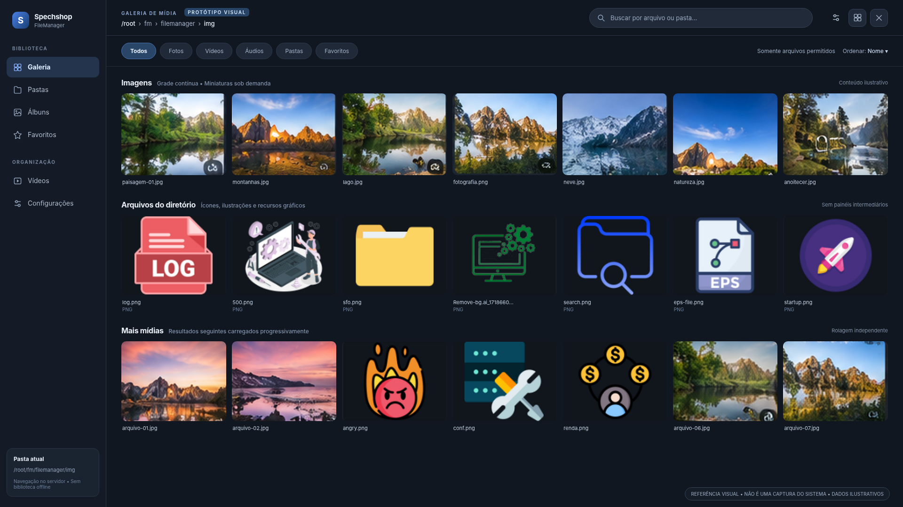

# Galeria de Mídia — especificação de refatoração visual e funcional

> **Escopo:** experimento **exclusivamente local**, dentro da instalação de teste do Spechshop FileManager na VPS.  
> **Objetivo:** transformar a galeria atual em uma experiência organizada, compacta e centrada na mídia, inspirada nos princípios de interação do Google Fotos **desktop**, preservando o tema escuro e as funções do gerenciador.  
> **Entrega exigida:** código local funcional, capturas comparativas, testes e relato objetivo. **Nenhuma publicação, sincronização, alteração remota ou operação de versionamento.**

## 0. LEIA ANTES DE MODIFICAR QUALQUER ARQUIVO

A tentativa anterior **não atendeu à solicitação**. A captura atual mostra praticamente o mesmo problema: o conteúdo continua espremido na parte inferior da janela, enquanto a pesquisa, os filtros, os painéis de álbuns e as configurações ocupam várias linhas de interface e grandes áreas vazias.

Isto **não é** uma tarefa para trocar cores, diminuir margens em 2 px, renomear classes ou adicionar um estilo superficial aos botões. É uma refatoração **real da hierarquia visual e do fluxo de uso**.

### Captura da implementação atual — o que NÃO repetir

### Referência visual de destino — o que efetivamente implementar

**A referência é um protótipo visual ilustrativo, não uma captura do sistema em produção.** Seus nomes e imagens são exemplos. A disposição, a densidade visual, a posição da busca, a organização dos filtros e a prioridade dada à grade são os elementos a reproduzir. Não copiar literalmente marca, textos de exemplo ou dados fictícios. As fotos de exemplo servem apenas para ilustrar o layout, não para serem inseridas no acervo real.

**Regra de interpretação:** se o resultado ficar mais parecido com a captura **atual** do que com a imagem **de destino**, o trabalho está incompleto, independentemente da quantidade de CSS modificada.

---

## 1. Restrições operacionais inegociáveis

1. Trabalhar **somente** nos arquivos da instalação experimental existente na VPS, após confirmar o diretório correto.
2. **Não publicar, enviar, sincronizar ou atualizar nenhum repositório remoto.**
3. **Não executar comandos de Git nem operações de controle de versão**, inclusive para consultar, criar histórico, integrar ou enviar alterações.
4. **Não criar commits, branches, tags, propostas de integração ou rotinas de publicação.**
5. Não alterar instalações de produção, outras VPS, outros sites ou diretórios não relacionados ao experimento.
6. Não remover nem sobrescrever arquivos locais sem antes identificar se pertencem ao experimento e preservar uma cópia de segurança local quando necessário.
7. Não fazer limpeza genérica do armazenamento do navegador ou do servidor.
8. Não adicionar serviços, ferramentas de telemetria, bancos de dados ou dependências pesadas para implementar uma galeria.
9. Toda a validação deve ocorrer **localmente** na instalação experimental. O resultado termina na VPS e no relatório de testes.

**Não solicitar autorização para publicar ao final. Publicação está fora do escopo.**

## 2. Diagnóstico obrigatório da falha visual atual

Na captura de referência do estado atual (1920 × 786), observam-se:

- O cabeçalho ocupa uma faixa, seguido de uma faixa só com o título de pasta.
- A busca aparece isolada em uma segunda área.
- Os filtros aparecem dentro de um painel largo, alto e quase vazio.
- Álbuns e favoritos aparecem em outro painel que atravessa a largura da tela.
- Configurações avançadas aparecem em mais uma faixa.
- As miniaturas começam apenas depois de todas essas regiões, com parte da primeira fileira visivelmente cortada/empurrada.
- Controles como “Todas as pastas” ficam sem relação clara com a navegação.
- A galeria possui largura de desktop, mas a composição desperdiça a maior parte da altura útil.

O problema principal é **o layout dos componentes**, não apenas suas bordas.

### Mudanças que NÃO contam como correção

- Apenas reduzir `margin`, `padding` e `gap` nos painéis antigos.
- Apenas trocar os botões por pílulas sem mudar a posição dos blocos.
- Manter “Filtros”, “Álbuns e favoritos” e “Configurações avançadas” como três barras largas empilhadas.
- Colocar uma grade menor abaixo dessas barras.
- Esconder controles sem torná-los acessíveis em outro lugar.
- Adicionar animação sem reorganizar o conteúdo.

## 3. Layout desktop: estrutura obrigatória

Construir a interface usando as seguintes regiões, nesta ordem:

**A. Navegação lateral compacta (opcional e recolhível)**  
Galeria, Pastas, Álbuns e Favoritos. Se for usada, deve ser discreta e não dominar a largura. Não bloquear o projeto esperando uma sidebar perfeita: a grade e a barra superior têm prioridade.

**B. Cabeçalho superior único**  
Título “Galeria de mídia” / localização da pasta, campo de busca integrado, botões pequenos para ações secundárias e fechar. Não criar uma seção horizontal inteira apenas para repetir “Pasta e subpastas”.

**C. Barra de filtros compacta**  
Todos, Fotos, Vídeos, Áudios, Pastas e Favoritos; ordenação e opções secundárias à direita ou em um menu. **Uma linha**, não um painel expansível de largura total.

**D. Conteúdo — elemento dominante**  
Grade adaptativa de miniaturas, com cabeçalhos discretos de agrupamento quando aplicáveis. Não manter espaços ou painéis intermediários antes da primeira fileira de mídia.

**E. Visualizador imersivo**  
Aberto apenas quando uma mídia é selecionada, sem carregar todos os originais antecipadamente.

### Limites visuais de aceitação (desktop)

| Elemento | Meta objetiva |
|---|---|
| Cabeçalho principal | Até **76 px** de altura, aproximadamente |
| Barra de filtros | Até **54 px** de altura, aproximadamente |
| Espaço entre filtros e a primeira seção de mídias | Normalmente **até 24 px** |
| Início da primeira fileira de miniaturas | **Antes de 230 px do topo**, quando já existem resultados para exibir |
| Sidebar expandida, se houver | Preferencialmente **200–230 px**; recolhível |
| Área de mídia | Deve ocupar **a maior parte** da largura útil, sem cartões vazios |
| Espaço entre miniaturas | Aproximadamente **8–12 px** |
| Títulos e cabeçalhos de grupos | Uma linha compacta, sem painel de destaque |
| Progresso da busca | Discreto, sem criar uma faixa grande e permanente |

Essas medidas são critérios orientativos de layout, não desculpa para quebrar acessibilidade ou cortar texto. Em 1366 × 768 a primeira fileira precisa estar claramente visível **sem rolar a página**. Quando não houver resultados, mostrar um estado vazio intencional, sem ocupar toda a tela com filtros.

### Distribuição esperada

- **1920 px:** aproximadamente 6–8 miniaturas por linha, dependendo das proporções.
- **1366 px:** aproximadamente 4–6 miniaturas por linha.
- **Tablet:** 2–4 miniaturas por linha.
- **Celular:** normalmente 2 colunas, com navegação adaptada.

Não usar larguras fixas que causem scroll horizontal. Essas faixas de colunas são metas, não razões para recortar arbitrariamente as imagens.

## 4. Miniaturas e grade

- Suportar mídia mista: JPEG, PNG, SVG seguro, WebP, vídeos, áudio e formatos já reconhecidos pelo sistema.
- Preferir uma grade ajustada às proporções reais, como linhas justificadas ou CSS Grid responsivo, com miniaturas dimensionadas corretamente.
- Não esticar imagens. Não cortar conteúdo importante indiscriminadamente.
- Não transformar cada mídia em um cartão alto com grande área vazia.
- Manter nome do arquivo acessível; pode aparecer em legenda pequena ou no hover, respeitando o acesso por teclado e touch.
- Exibir indicadores compactos de tipo e duração para vídeo, quando esses dados existirem.
- Para áudio, mostrar identidade visual consistente e oferecer player real ao abrir.
- Dar destaque visual a seleção, favoritos e estado de carregamento.
- Tratar arquivos que falham ou não têm miniatura sem quebrar a grade.
- Usar carregamento incremental; evitar milhares de nós DOM e downloads simultâneos.

A grade deve aparecer progressivamente enquanto o scanner encontra arquivos. Não aguardar o final da busca recursiva para começar a desenhar os resultados.

## 5. Pesquisa, filtros, navegação e agrupamentos

- Campo de pesquisa no topo, com placeholder claro: “Buscar por arquivo ou pasta”.
- Busca por nome e caminho relativo, respeitando a lógica já existente.
- Filtros: Todos, Fotos, Vídeos, Áudios, Pastas, Favoritos.
- Filtros devem continuar funcionando durante o escaneamento.
- Preservar opção de **pasta atual vs. subpastas**, mas colocá-la em controle compacto e semanticamente claro.
- Preservar álbuns e favoritos; reposicioná-los na navegação ou em menus compactos.
- Agrupar por Pasta ou Data, quando solicitado. Também permitir visualização sem agrupamento.
- Não usar datas inventadas ou inferidas sem fonte confiável.
- Opções avançadas de apresentação devem ficar em popover/menu, não em painéis permanentes.
- Permitir atualizar/reiniciar uma busca sem perder o controle da interface.
- Exibir contador de resultados encontrados e situação da descoberta.

**Progresso esperado:** texto compacto, por exemplo `42 pastas verificadas · 135 pendentes · 2 arquivos`, um indicador fino e ação de cancelar. Quando a busca acabar, o indicador desaparece e a barra de ferramentas não fica com espaço reservado vazio.

## 6. Visualizador de mídia

Ao clicar numa miniatura, abrir um visualizador separado, escuro e imersivo:

- Imagem ajustada à tela, sem deformação.
- Zoom e pan; opção “ajustar à tela / tamanho original”.
- Setas esquerda/direita para navegar, `Esc` para fechar.
- Controles visíveis para teclado e touch.
- Nome, tipo, tamanho e demais metadados disponíveis num painel discreto.
- Ações de download e outras operações somente quando autorizadas.
- Player nativo/adequado para vídeo e áudio.
- Reutilizar/encerrar recursos corretamente ao passar de uma mídia para outra.
- Não abrir simultaneamente múltiplos players nem carregar todos os arquivos completos.

## 7. Privacidade, cache e memória — requisito bloqueante

Uma tentativa anterior teria persistido imagens no navegador. Isso não foi solicitado e **não deve continuar acontecendo**.

Investigar o comportamento existente (não presumir a causa) em:

- Cache API e Service Workers.
- IndexedDB.
- localStorage e sessionStorage.
- HTTP cache e cabeçalhos de resposta.
- `Blob`, `URL.createObjectURL()` e `URL.revokeObjectURL()`.
- Bibliotecas de thumbnails e pré-carregamento.

**Política esperada:**

1. Não gravar conteúdo binário de mídias privadas em cache persistente do aplicativo.
2. Não criar biblioteca offline.
3. Não manter cópias permanentes no navegador após fechar a sessão/galeria.
4. Avaliar `Cache-Control: private, no-store` para respostas autenticadas com mídias privadas; preservar cache normal dos assets públicos estáticos.
5. Requisitar **miniaturas**, não originais enormes, para a grade.
6. Limitar concorrência; cancelar downloads e gerações obsoletas.
7. Revogar Object URLs **somente quando não estiverem mais em uso**.
8. Remover event listeners e liberar players, elementos e buffers na desmontagem da galeria.
9. Não guardar tokens ou URLs temporárias sensíveis de modo persistente.
10. Se existir armazenamento legado da galeria, limpar **apenas** os dados identificados como próprios dela, sem apagar dados de outras funcionalidades.

Não usar “esvaziar todo o cache do navegador” como solução. O sistema precisa gerenciar seus próprios dados corretamente.

## 8. Escaneamento recursivo e grandes diretórios

Preservar a busca da pasta atual e subpastas, inclusive cancelamento e andamento incremental.

- Exibir resultados na medida em que chegam.
- Manter a UI interativa durante a busca.
- Não percorrer caminhos fora do escopo autorizado.
- Evitar varreduras duplicadas e requisições concorrentes descontroladas.
- Lidar com permissões negadas, arquivos inválidos, diretórios vazios e caminhos longos.
- Não carregar 1000 miniaturas/originais simultaneamente.
- Avaliar paginação, janela virtual e IntersectionObserver conforme perfil de carga.
- Usar as estruturas existentes da aplicação sempre que possível.

## 9. Segurança

Não enfraquecer o modelo de permissões existente. Verificar em toda requisição:

- Autorização de leitura do arquivo e da miniatura.
- Proteção contra path traversal e symlinks que escapem da raiz permitida.
- Sanitização segura de nomes e metadados para evitar XSS.
- MIME adequado e não execução de conteúdo ativo não confiável.
- Ausência de vazamento desnecessário de caminhos absolutos, credenciais e tokens.
- Limites para arquivos excessivamente grandes.
- Tratamento de erro sem expor informações sensíveis.

## 10. Sequência de execução local

1. **Inspecionar** os arquivos da galeria experimental e identificar HTML, CSS, JS, endpoints PHP, geração de miniaturas, busca e cache.
2. **Registrar** quais partes da experiência atual precisam ser preservadas.
3. Fazer cópia **local** dos arquivos que serão alterados, em local não público.
4. **Reestruturar o HTML**, em vez de somente retocar os painéis existentes.
5. Implementar o novo layout segundo a imagem `galeria_referencia_desktop.png`.
6. Integrar busca, filtros, agrupamentos, favoritos e álbuns ao novo layout.
7. Corrigir cache, memória, carregamento progressivo e cancelamento.
8. Validar visualmente em desktop e mobile com **capturas de tela reais do navegador**.
9. Fazer testes funcionais, de segurança e de desempenho.
10. Corrigir todas as divergências críticas antes de declarar conclusão.

Não instalar dependências novas sem necessidade técnica demonstrada. Não modificar outras áreas do FileManager para alcançar o visual desejado.

## 11. Evidência obrigatória: comparação antes/depois

**Uma resposta textual dizendo “concluído” não prova a correção.** Entregar capturas com a galeria funcionando, não screenshots de um HTML estático isolado.

Capturas requeridas:

| Prova | O que deve ficar visível |
|---|---|
| Antes — 1920 × 1080 ou captura de origem | Espaço desperdiçado, posição antiga dos filtros e miniaturas |
| Depois — 1920 × 1080 | Cabeçalho, uma linha de filtros, primeira e demais fileiras de mídias |
| Depois — 1366 × 768 | Primeira fileira visível sem scroll e ausência de painéis gigantes |
| Depois — celular | Pesquisa acessível, filtros responsivos e grade sem scroll lateral |
| Visualizador | Imagem aberta com navegação e controles |
| Durante busca recursiva | Progresso discreto, primeiros resultados aparecendo e cancelamento |

Depois de renderizar, comparar explicitamente o resultado com `galeria_referencia_desktop.png`, descrevendo divergências e corrigindo-as. Se a primeira fileira continuar começando perto do meio da tela, **a refatoração falhou**.

## 12. Testes obrigatórios

- Abrir/fechar/reabrir galeria sem duplicar listeners.
- Buscar pela pasta atual e por subpastas.
- Cancelar a descoberta e reiniciá-la.
- Pesquisar e filtrar enquanto os resultados chegam.
- Alternar entre Todos, Fotos, Vídeos, Áudios, Pastas e Favoritos.
- Navegar por pastas, álbuns e favoritos.
- Abrir JPG, PNG, SVG seguro, WebP, vídeo e áudio compatíveis.
- Lidar com arquivo sem miniatura, erro de acesso e mídia corrompida.
- Navegar com mouse, teclado e touch.
- Validar 1920 × 1080, 1366 × 768, tablet e mobile.
- Verificar ausência de scroll horizontal.
- Abrir/fechar muitas mídias e monitorar crescimento de memória.
- Confirmar ausência de persistência indevida em IndexedDB, Cache API e storages.
- Confirmar que endpoints de arquivos e miniaturas exigem autorização.
- Testar diretórios com centenas ou milhares de mídias sem congelamento.
- Validar que a galeria não afetou operações de outras áreas do FileManager.

**Ao relatar desempenho:** fornecer quantidade de arquivos, configuração do teste e medidas observadas. Não alegar ganhos não medidos.

## 13. Critérios de conclusão — todos devem passar

- [ ] O visual final se aproxima da **imagem de destino**, não da captura antiga.
- [ ] O cabeçalho e a barra de filtros são compactos.
- [ ] Não existem três grandes painéis empilhados antes da grade.
- [ ] Em 1366 × 768, a primeira fileira de miniaturas é visível sem scroll.
- [ ] A área principal é dominada por miniaturas, não por formulários.
- [ ] Pastas, álbuns, favoritos e configurações permanecem acessíveis.
- [ ] Busca recursiva, cancelamento e carregamento progressivo funcionam.
- [ ] Visualizador, áudio e vídeo funcionam.
- [ ] A grade é responsiva e não deforma mídias.
- [ ] Não há armazenamento persistente não autorizado de arquivos privados.
- [ ] Autorização e isolamento dos arquivos continuam corretos.
- [ ] Testes reais foram executados e seus resultados registrados.
- [ ] Foram produzidas capturas **do sistema experimental funcionando**.
- [ ] Nenhum arquivo foi publicado, sincronizado ou enviado para fora do experimento.

## 14. Formato da resposta final do agente

Responder com:

1. **Arquivos locais modificados:** caminhos precisos.
2. **Alterações de UX:** como foi eliminada a área desperdiçada.
3. **Alterações técnicas:** busca, miniaturas, cache, gerenciamento de recursos.
4. **Teste visual:** links/caminhos das capturas locais (1920 × 1080, 1366 × 768, mobile e visualizador).
5. **Testes funcionais:** quais passaram, quais falharam, com evidência.
6. **Privacidade:** onde antes havia persistência, se confirmada, e qual foi a correção.
7. **Limitações pendentes:** listar honestamente, sem dizer que terminou se faltarem os critérios.

**Não publicar, não sincronizar, não criar histórico de alterações e não operar em nenhum remoto.** Esta é somente uma experimentação dentro da VPS.

---

### Instrução final

**Implemente uma galeria que pareça uma galeria, não uma página de filtros com arquivos embaixo.** Use a imagem de destino como régua visual de aprovação e as capturas do navegador como prova. Não declare conclusão enquanto o layout continuar parecido com o estado atual.
