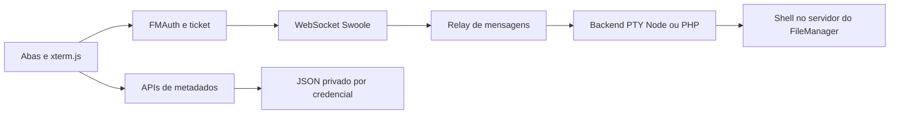

# Plano de redesign do terminal do FileManager

Data: 21/11/2026. Base consultada: checkout atual, commit `d5d8bef`, incluindo os arquivos presentes na árvore de trabalho.

## 1. Direção recomendada

Transformar o terminal em uma área de trabalho própria do FileManager, com navegação de sessões, abas arredondadas, superfícies escuras em camadas e uma experiência móvel dedicada. A aproximação visual com o Termius depende principalmente dessa composição; trocar somente as cores do xterm manteria a estrutura atual de painel auxiliar do editor.

A implementação deve reaproveitar xterm.js e os backends PTY existentes. O primeiro objetivo é entregar uma experiência de terminal visualmente próxima da referência, preservando edição de arquivos, autenticação, permissões, reconexão e perfil de shell.

Este documento contém análise e planejamento. A interface atual foi estudada pelo código; não foi executada uma sessão autenticada nem feita uma comparação de capturas do FileManager em funcionamento. As imagens públicas do Termius foram inspecionadas visualmente. Dimensões, cores e prazos abaixo são propostas para o FileManager, sujeitas à validação em protótipo.

## 2. Como o projeto e o terminal funcionam hoje

### 2.1 Estrutura relevante

O projeto reúne gerenciador de arquivos, editor Monaco e terminal no navegador, com PHP/Swoole no servidor e serviços auxiliares em Node.js. A interface usa HTML, JavaScript, jQuery e Bootstrap, sem uma aplicação React/Vue ou um pipeline de frontend declarado em `package.json`.

O README ajuda na orientação, mas há descrições de dependências antigas. Para este plano, o código e os manifests atuais prevalecem.

| Camada | Arquivo atual | Papel no redesign |
|---|---|---|
| Página efetiva | [`plugins/Request/pages/index.html`](../plugins/Request/pages/index.html) | Importa o módulo do editor e carrega `css/mobile.css`; ponto de entrada para o acesso dedicado ao terminal. |
| Interface e controle | [`plugins/Request/modules/modalEditCode.html`](../plugins/Request/modules/modalEditCode.html) | Concentra marcação, estilos, criação de abas, xterm, WebSocket, persistência e adaptação móvel. Tem mais de 4.500 linhas, incluindo outras funções do editor. |
| Adaptação móvel | [`css/mobile.css`](../css/mobile.css) | Modos editor/terminal, abas, teclas extras, safe areas e ajustes para teclado aberto. |
| Transporte autenticado | [`js/auth-transport.js`](../js/auth-transport.js) | Expõe `FMAuth`, valida acesso, converte credenciais de HTTP para cabeçalho e cria tickets para WebSocket. |
| Entrada de WebSocket | [`plugins/OpenConnection/websocket/OpenConnection.php`](../plugins/OpenConnection/websocket/OpenConnection.php) | Valida origem, proprietário e autorização da conexão. |
| Relay do terminal | [`plugins/Message/server/server.php`](../plugins/Message/server/server.php) | Encaminha entrada e saída entre navegador e serviço PTY. |
| PTY Node | [`pty.js`](../pty.js) | Usa `node-pty`, mantém processos, clientes e cache de saída em memória. |
| PTY PHP | [`pty.php`](../pty.php) | Alternativa com PHP/Swoole, `proc_open` e PTY; implementa o mesmo protocolo interno de comandos. |
| Sessões salvas | [`getTerminals.php`](../plugins/Request/apps/getTerminals.php), [`saveTerminal.php`](../plugins/Request/apps/saveTerminal.php), [`deleteTerminal.php`](../plugins/Request/apps/deleteTerminal.php) | Listam, salvam e removem metadados por credencial, usando armazenamento JSON privado. |
| Ambiente do shell | [`scripts/terminal-profile.sh`](../scripts/terminal-profile.sh) | Carrega o ambiente gerenciado das sessões; deve continuar funcionando. |

`plugins/Extension/plugins/terminal.php`, apesar do nome, contém utilitários de subprocesso e supervisão. O emulador e a experiência interativa estão principalmente em `modalEditCode.html`, `pty.js` e `pty.php`.

### 2.2 Fluxo de uma sessão



No navegador, o controle usa mensagens JSON com `command` e `isCodex: true`. Esse campo também é usado pelo terminal comum; seu nome não significa que a sessão seja uma tarefa do agente Codex. O relay converte comandos de resize em mensagens internas separadas para comando, colunas e linhas.

As sessões são identificadas pela combinação do proprietário com o ID do terminal. O backend Node usa Bash no Linux e PowerShell no Windows; o diretório inicial vem da configuração de ambiente ou de `files/`.

**Distinção essencial:** o terminal abre um shell na máquina que hospeda o FileManager. O usuário pode executar `ssh` dentro desse shell, mas as camadas examinadas não fornecem um catálogo próprio de hosts SSH com credenciais, negociação de conexão e gerenciador SFTP equivalente ao Termius. O redesign precisa representar esse funcionamento real.

### 2.3 Recursos que já existem

- Várias abas, criação de sessão, seleção, fechamento e restauração pela API.
- Renomeação por clique duplo e menu contextual com renomear, duplicar, criar, fechar outros e fechar.
- Duplicação que cria outra sessão com nome derivado; não clona o estado do processo original.
- xterm.js 5.3.0, carregado por CDN com integridade no JavaScript, scrollback de 5.000 linhas e cursor piscante.
- `Ctrl+C` copia quando existe seleção; sem seleção, segue para o terminal. `Ctrl+V` usa `term.paste()`.
- Entrada de teclado e sequências de mouse encaminhadas por `onData`.
- Sessões PTY preservadas em desconexões transitórias, com cache recente de saída para retomada.
- Teclas extras no celular: Esc, Tab, Ctrl+C, setas, Home, End, `/`, `|` e `~`.
- Alternância móvel editor/terminal, detecção de teclado por `visualViewport` e ajustes de safe area.

Há três persistências distintas: `storageTerminals` e `xtermDimensions` no navegador; nomes/IDs em `sessions-terminals.json` no servidor; IDs do backend em `terminals.json`. O caminho dos arquivos no servidor pode ser redirecionado por configuração. Os processos e o replay permanecem em memória: salvar IDs não mantém shells vivos após reiniciar o serviço. O desligamento por tempo desconectado tem padrão configurável de 30 minutos.

### 2.4 Limitações e consequências para o desenho

| Observação no código | Consequência | Direção proposta |
|---|---|---|
| `.footer-terminal` é um rodapé fixo dentro do modal do editor. | O terminal herda a hierarquia e o espaço de uma ferramenta auxiliar. | Área dedicada com opção de voltar ao painel integrado. |
| Fundo do xterm preto, cursor ciano e estilos de abas misturados com regras gerais do editor. | Terminal e controles não formam um conjunto visual consistente. | Tokens próprios, aplicados ao contêiner e ao emulador. |
| Resize estima colunas por `largura / 9` e linhas por `altura / 17`. | Alterar fonte, espaçamento ou layout pode cortar conteúdo. | Medir o contêiner visível com addon de ajuste. |
| `xtermDimensions` guarda uma geometria compartilhada, incluindo alturas do editor. | Dimensões antigas podem ser inadequadas em outro viewport. | Salvar preferências de layout e recalcular a grade real. |
| Aba, instância xterm, socket e metadados são controlados no mesmo bloco. | Mover a apresentação pode recriar sessões ou duplicar handlers. | Separar estado, transporte e visualização. |
| Reconexão usa espera fixa de três segundos e mensagens no console. | A tela não explica ao usuário a situação da conexão. | Estados explícitos e ação de reconectar. |
| `.terminal-live-dot` é decorativo, sem vínculo com o socket. | Pode sugerir atividade sem confirmar conexão. | Indicador dirigido pelo estado real. |
| Fechamento remove DOM e registro sem chamada explícita a `terminal.dispose()`. | O ciclo de vida merece revisão antes de adicionar novas vistas. | Descartar instâncias, addons, listeners e timers ao encerrar. |
| O botão fechar envia encerramento do PTY quando conectado. | Fechar aba pode terminar processos em execução. | Diferenciar ocultar a área de trabalho e encerrar uma sessão. |
| O CSS móvel acumula blocos para os mesmos seletores. | Mudanças podem depender da ordem da cascata e de `!important`. | Consolidar regras do terminal por modo e breakpoint. |
| Renomeação e menu contextual dependem de gestos de desktop. | Ações ficam pouco descobertas no toque. | Menu visível de três pontos e painel de ações móvel. |

As rotinas atuais de API convertem várias falhas em objetos/listas vazios. O novo painel deve distinguir “sem sessões” de “não foi possível carregar”. Também é necessário cancelar tentativas de reconexão pendentes quando uma sessão é encerrada.

## 3. Pesquisa breve do Termius

### 3.1 Linux: estrutura de aplicação

A página apresenta navegação por hosts e grupos, pesquisa/conexão rápida e recursos como múltiplas abas e divisão de tela. Esses elementos organizam a experiência em torno das conexões. Referência: [Termius para Linux](https://termius.com/free-ssh-client-for-linux).

Na [captura desktop publicada nessa página](https://framerusercontent.com/images/5XSLw1frNuP7hNYRiiNpKw2EXE.png?height=611&width=1027), aparecem barra superior, navegação lateral, cartões arredondados e ícones coloridos. A [captura do terminal](https://framerusercontent.com/images/8PI1KU8vjvwZ5zXoqzbzEmHnGs.jpg?height=1394&width=2120) mostra fundo azul muito escuro e abas preenchidas, com uma seleção verde discreta. A separação entre superfícies pesa mais que bordas fortes.

### 3.2 iPhone: seleção de conexões e sessão ativa

A página destaca múltiplas abas e teclado extra. Referência: [Termius para iPhone](https://termius.com/free-ssh-client-for-iphone).

A [imagem de conexões](https://framerusercontent.com/images/0VmqOSYLQq5l6kI8hIzJewynE.png?height=2114&width=1073) combina interface clara, busca e cartões com prévias de terminal. A [imagem da sessão ativa](https://framerusercontent.com/images/CUVXNg4ojhN5scEuoVJl68GrPas.png?height=5437&width=2683) usa terminal escuro, seletor de sessões na parte inferior e teclas auxiliares acima do teclado do sistema. São estados diferentes; a lista em cartões não ocupa a tela enquanto o usuário digita.

### 3.3 Interpretação para o FileManager

Adotar duas vistas complementares: **biblioteca de sessões** para encontrar e organizar; **sessão ativa** para trabalhar. A biblioteca pode mostrar cartões, enquanto a sessão reserva espaço para conteúdo e controles compactos.

O tema escuro deve ser a primeira entrega por combinar com o editor atual. Um tema claro para a biblioteca pode vir depois. A marca, os textos e os ícones devem continuar pertencendo ao FileManager. As capturas servem como referência de composição, sem introduzir botões de protocolos ou serviços que ainda não existem.

## 4. Experiência proposta

### 4.1 Desktop: terminal como área de trabalho

Disponibilizar um acesso “Terminal” que abra a área dedicada, sem exigir abrir um arquivo. Manter o modo integrado ao editor como alternativa, utilizando as mesmas sessões.

Composição inicial sugerida para larguras a partir de 1.024 px:

```text
┌──────────────────────────────────────────────────────────────────────┐
│ FileManager   Arquivos   Editor   Terminal          Preferências     │
├────────────────┬─────────────────────────────────────────────────────┤
│ Buscar sessões │ [Servidor local ×] [Build ×] [+]   Buscar  Dividir ⋯ │
│                ├─────────────────────────────────────────────────────┤
│ Sessões        │                                                     │
│ Favoritas      │                  terminal ativo                     │
│ Grupos         │                                                     │
│                │                                                     │
│ + Nova sessão  ├─────────────────────────────────────────────────────┤
│                │ Conectado · Shell do servidor              120 × 32 │
└────────────────┴─────────────────────────────────────────────────────┘
```

Proporções iniciais: lateral de 224 px, recolhível; cabeçalho de 48 px; faixa de abas de 44 px; status de 24 px. Usar CSS Grid/Flex e `min-width: 0`/`min-height: 0` para o conteúdo se ajustar. O terminal dedicado deve acompanhar o tamanho do contêiner, sem offsets fixos do editor.

Abas devem usar fundo preenchido, raio de 10–12 px, ícone, nome e estado. O fechamento fica discreto, acessível ao foco de teclado. Nomes completos aparecem em tooltip e na biblioteca; a truncagem não pode tornar a sessão irreconhecível.

Na biblioteca: busca por nome, lista ou grade, favoritos e grupos simples. O primeiro cartão representa uma sessão de shell do servidor atual. Ícones de sistema operacional só devem aparecer quando houver metadado confiável; inicialmente, usar um ícone de terminal.

### 4.2 Celular: separar organização e digitação

Usar o breakpoint móvel existente, abaixo de 768 px, como ponto de partida:

1. **Biblioteca:** título, busca, botão de nova sessão e cartões com nome, estado e ações. Inicialmente, sem miniaturas vivas; isso evita várias renderizações de terminal simultâneas.
2. **Sessão ativa:** cabeçalho mínimo, xterm ocupando a área disponível e faixa inferior com voltar, sessão atual, criar e abrir seletor de sessões.
3. **Teclado aberto:** esconder informações secundárias e manter teclas auxiliares imediatamente acima do teclado nativo. Conservar sessão, cursor e foco ao mudar a geometria.

```text
┌─────────────────────────────┐
│ ‹ Sessões       Build     ⋯ │
├─────────────────────────────┤
│                             │
│         xterm ativo         │
│                             │
├─────────────────────────────┤
│ ‹  [Build ●]       +    ▦   │
├─────────────────────────────┤
│ Esc Tab Ctrl Alt / | ~  ↑   │
├─────────────────────────────┤
│     teclado do sistema      │
└─────────────────────────────┘
```

A mudança das abas para a região inferior deve ser testada com teclado aberto e fechado. Não empilhar permanentemente cabeçalho do modal, seletor editor/terminal, título “SESSÕES”, abas e status. Navegação entre Arquivos/Editor/Terminal fica na biblioteca ou se recolhe durante a digitação.

Manter Esc, Tab e setas; acrescentar Ctrl e Alt com estado visual de uso único, liberado após a próxima tecla. Ctrl+C continua disponível diretamente. Todas as teclas devem passar pelo mesmo controle de entrada da sessão ativa, respeitando indisponibilidade do socket.

Preservar `visualViewport`, safe areas e a textarea do xterm com tamanho que evite zoom involuntário. Revisar os eventos de toque: o tratamento atual em `touchstart` com `preventDefault` precisa ser avaliado para não impedir a rolagem horizontal das teclas nem gerar envio duplicado.

### 4.3 Tablet e telas intermediárias

Entre 768 e 1.023 px, usar lateral em gaveta e abas compactas. Em orientação horizontal, permitir dois painéis apenas quando cada um mantiver largura útil. Abaixo desse limite, a mesma composição deve voltar a uma sessão visível sem encerrar a outra.

### 4.4 Interações e estados

| Ação/estado | Comportamento esperado |
|---|---|
| Nova sessão | Cria um shell, mostra “Conectando” e permite nomear sem bloquear o início. |
| Selecionar sessão existente | Reutiliza instância e socket; restaura foco sem recriar o processo. |
| Ocultar workspace ou voltar ao editor | Preserva a sessão; não envia comando de encerramento. |
| Encerrar sessão | Ação explícita, distinta de ocultar. Confirmação nas ações em lote; mensagem clara sobre término do shell. |
| Duplicar | Abre outro shell com nome derivado; texto não promete clonar processos ou diretório atual. |
| Conectando/reconectando | Estado textual e ícone; entrada temporariamente desabilitada, sem fila oculta de comandos. |
| Rede indisponível | Mantém conteúdo visível e oferece nova tentativa. |
| Acesso expirado/negado | Suspende novas tentativas conforme `FMAuth`; orienta renovar o acesso. |
| Carregamento da lista falhou | Mensagem de erro e tentar novamente, diferente da lista vazia. |
| Sessão encerrada | Não deve entrar em reconexão infinita. Exige identificar término definitivo no protocolo. |
| Busca no terminal | Campo sobreposto com próximo/anterior; atalhos só quando o terminal tiver foco. |

A interface atual não conhece com segurança o processo em primeiro plano. A primeira versão não deve afirmar que uma sessão está “ociosa” ou “segura para fechar”.

### 4.5 Zoom do terminal

O zoom deve ser um recurso explícito da primeira versão. Hoje, a criação do xterm não configura `fontSize` nem oferece controles para alterá-lo; as referências a tamanho de fonte em outras partes do módulo pertencem ao editor Monaco. A proposta anterior de preferências de fonte era insuficiente para definir essa interação.

O zoom do terminal altera o tamanho dos caracteres e recalcula quantas colunas e linhas cabem no painel. Maximizar o painel aumenta sua área disponível e deve continuar sendo uma ação separada. Ambos preservam a sessão e o processo em execução.

#### Controles e comportamento

| Contexto | Proposta |
|---|---|
| Desktop | Controle compacto `−  100%  +` na barra do terminal, com opção “Restaurar tamanho padrão”. Em largura reduzida, agrupar em um botão com ícone e rótulo “Zoom”. |
| Celular | Ação “Tamanho do texto” no menu da sessão, abrindo painel com diminuir/aumentar, tamanho em px, percentual e restauração. O painel deve funcionar também com o teclado aberto. |
| Teclado físico | Atalhos configuráveis para aumentar, diminuir e restaurar. Proposta inicial: `Ctrl+Shift+=`, `Ctrl+Shift+-` e `Ctrl+Shift+0`, com equivalentes usando Command no macOS, sujeitos à validação de conflitos no navegador e no sistema. Os botões permanecem disponíveis se o ambiente reservar um atalho. |
| Mouse/trackpad | Oferecer “Ctrl + rolagem ajusta o texto do terminal” como preferência opcional. Quando habilitada, capturar somente eventos sobre o painel ativo; normalizar deltas e limitar a cadência. Fora dele, preservar o comportamento do navegador. |
| Toque | Prototipar pinça com dois dedos para ajustar a fonte, mediante preferência explícita “Pinça ajusta o texto do terminal”. Validar separadamente em Safari/iOS e Chrome/Android antes de habilitar por padrão. |
| Dois painéis | O ajuste imediato afeta apenas o painel ativo. Disponibilizar “Aplicar tamanho a todos os terminais” nas preferências. |

Propor faixa inicial de **10 a 32 px**, em passos de **1 px**, com base de **14 px = 100%**. Mostrar o percentual arredondado junto ao valor real, por exemplo `18 px · 129%`, para não sugerir uma precisão inexistente. Esses limites são escolhas iniciais de produto e devem ser revistos com testes de leitura e densidade.

O tamanho padrão pode ser configurado separadamente para desktop e celular. Alterar o padrão vale para novas sessões; “Restaurar” usa o padrão vigente no dispositivo. Um ajuste individual permanece ao trocar de aba, reconectar e alternar entre terminal dedicado e integrado.

Guardar a preferência por identidade autenticada, classe de dispositivo e sessão. Ao abrir em outro dispositivo, usar seu padrão local em vez de importar automaticamente a escala de uma tela diferente. O menu deve informar “Tamanho do texto neste dispositivo”.

#### Pinça, rolagem e acessibilidade

A pinça é uma melhoria desejada para aproximar a interação móvel da experiência de um aplicativo. Sua viabilidade e seu conforto no navegador precisam ser demonstrados no protótipo; esta proposta não afirma que o Termius implemente exatamente esse gesto.

O reconhecimento deve começar apenas com dois pontos de toque dentro da superfície do terminal. Um dedo continua reservado à rolagem, seleção e interação com o terminal. Usar um limiar inicial para evitar mudanças involuntárias, calcular a escala pela distância entre os dedos e encerrar o gesto em cancelamento, perda de foco ou saída da sessão. Não enviar toques usados no gesto como entrada de mouse para o PTY.

Não aplicar `transform: scale()` ou a propriedade CSS `zoom` ao canvas: isso ampliaria visualmente a imagem sem ajustar corretamente a grade do terminal. Também não desabilitar globalmente o zoom do navegador com `user-scalable=no`, `maximum-scale=1` ou bloqueios de toque na página inteira.

O zoom de página deve continuar acessível. Como pinça e Ctrl + rolagem também podem ser interpretados pelo navegador, as preferências precisam explicar qual comportamento será usado sobre o terminal. A implementação deve validar a política de gestos da superfície, inclusive as restrições de `touch-action`, antes do início do gesto. Se a captura local comprometer seleção, rolagem ou acessibilidade, manter o gesto nativo e entregar o zoom por botões e menu.

#### Resultado esperado durante o ajuste

- Atualizar o texto sem recriar xterm, socket ou shell, com indicação temporária do tamanho escolhido.
- Manter o cursor visível quando a tela estiver acompanhando a saída. Quando o usuário estiver no histórico, preservar aproximadamente a região de leitura, considerando a redistribuição de linhas.
- Ajustar a grade e comunicar suas novas dimensões ao PTY. Aplicativos como `vim` e `htop` devem receber a alteração e redesenhar corretamente.
- Não enviar caracteres, comandos ou atalhos consumidos pelo zoom ao shell.
- Manter as barras de navegação e as teclas extras no tamanho da interface; somente o conteúdo do terminal recebe a escala individual.

## 5. Especificação visual inicial

Os valores são uma paleta proposta, inspirada nas imagens, sem pretensão de reproduzir tokens internos do Termius.

| Token | Valor inicial | Uso |
|---|---|---|
| `--terminal-bg` | `#141627` | Área do emulador. |
| `--terminal-sidebar-bg` | `#1B1D31` | Navegação lateral. |
| `--terminal-surface` | `#222439` | Cartões e abas inativas. |
| `--terminal-surface-hover` | `#2B2E46` | Hover e superfícies elevadas. |
| `--terminal-border` | `#33364D` | Separadores discretos. |
| `--terminal-text` | `#E8E9F0` | Texto principal. |
| `--terminal-text-muted` | `#A3A7BA` | Informação secundária. |
| `--terminal-accent` | `#47C99B` | Seleção e estado conectado. |
| `--terminal-accent-bg` | `#183C38` | Fundo da aba selecionada. |
| `--terminal-focus` | `#89B4FF` | Foco de teclado. |
| `--terminal-warning` / `--terminal-danger` | `#F2C572` / `#F07B86` | Avisos e encerramento. |

Usar tipografia de sistema na navegação, 13–14 px no desktop e 15–16 px no celular. No terminal, propor `JetBrains Mono, ui-monospace, monospace`, 14 px e altura de linha 1,2 como início, com preferências de fonte e tamanho. Confirmar disponibilidade da fonte e ajustar a grade após seu carregamento.

Definir também os 16 tons ANSI, cursor, seleção e cores intensas no tema do xterm. Alterar apenas o CSS externo deixaria a saída visualmente desconectada. As opções de fonte, tema e contraste são suportadas pela [API de opções do xterm.js](https://xtermjs.org/docs/api/terminal/interfaces/iterminaloptions/); a implementação deve conferir sua disponibilidade na versão realmente carregada.

Adotar espaçamento em múltiplos de 4 px, cartões com raio de 14 px, controles com raio de 8 px e ícones consistentes do conjunto já utilizado. Evitar brilho permanente, sombras grandes e bordas saturadas no terminal. Estados devem usar texto ou ícone além da cor.

Metas de acessibilidade: contraste de texto de pelo menos 4,5:1, foco visível, navegação por teclado e alvos de toque de pelo menos 44 × 44 px. O modo leitor de tela deve ser considerado nas preferências. Os pares de cor precisam ser medidos no protótipo, especialmente ANSI e seleção.

## 6. Arquitetura de implementação

### 6.1 Separar responsabilidades sem trocar o framework

Extrair gradualmente o bloco do terminal para arquivos próprios. Nomes sugeridos, ainda inexistentes:

- `js/terminal/session-store.js`: metadados, sessão ativa e sincronização com a API.
- `js/terminal/transport.js`: FMAuth, socket, estado, retries e protocolo atual.
- `js/terminal/terminal-view.js`: xterm, addons, entrada, foco e descarte.
- `js/terminal/workspace.js`: biblioteca, abas, painel integrado e modo dedicado.
- `css/terminal.css`: tokens, componentes e regras responsivas do terminal.
- `plugins/Request/modules/terminalWorkspace.html`: marcação reutilizável da área dedicada.

Usar scripts compatíveis com o carregamento atual. Não exigir React, bundler ou migração do editor para entregar o redesign. Preservar inicialmente os IDs e aliases usados pelo restante da aplicação, incluindo `createTabTerminal` e `runCommand`, até localizar e adaptar seus consumidores.

Cada sessão terá uma única instância de controle e um socket por cliente. Mudar a apresentação não deve criar outro PTY. Reorganizar o contêiner da sessão ou alternar vistas sob um mesmo workspace; validar foco e renderização ao mover elementos. Uma miniatura futura deve ser uma captura pontual, sem conexão extra.

### 6.2 Corrigir geometria antes de sofisticar o layout

Adicionar um addon de ajuste compatível com a versão escolhida de xterm. A documentação oficial demonstra o uso de `Terminal.loadAddon` e `FitAddon.fit()` para adequar a grade ao contêiner: [guia de addons](https://xtermjs.org/docs/guides/using-addons/).

Não combinar automaticamente o xterm 5.3.0 atual com a versão mais recente de um addon. Fixar e validar um conjunto compatível; se houver atualização do emulador, tratá-la como mudança própria, com seus checks de integridade e regressão.

Observar tamanho do painel com `ResizeObserver`, agrupar ajustes em `requestAnimationFrame` e executar o fit apenas em painéis visíveis com área positiva. Refazer o ajuste após seleção de aba, carregamento de fonte, teclado móvel e mudança entre modos. Encaminhar o resize resultante pelo protocolo existente, evitando mensagens repetidas para uma grade inalterada.

Salvar altura preferida do painel integrado, largura da lateral e proporção da divisão. Colunas e linhas devem ser derivadas do viewport atual, com limites válidos. Migrar `xtermDimensions` sem reaplicar cegamente largura de outro dispositivo.

Centralizar o zoom em uma operação de visualização, por exemplo `setTerminalFontSize(sessionId, size)`, compartilhada por botões, atalhos, rolagem e pinça. Ela deve validar os limites, atualizar `terminal.options.fontSize`, executar o fit após a atualização das métricas e salvar a preferência. Conferir essa API no xterm efetivamente utilizado. Os pixels anteriores de largura de caractere e altura de linha não podem continuar fixos após a mudança da fonte.

Durante um gesto contínuo, agrupar alterações em frames de animação e limitar mensagens de resize para não sobrecarregar o relay. Enviar sempre a dimensão final ao concluir o gesto. O ajuste inicial deve ocorrer quando o contêiner estiver visível e a fonte carregada; se estiver oculto, marcar o fit como pendente. Não adicionar um segundo caminho independente de resize para o zoom.

### 6.3 Estado e persistência

Separar metadados persistidos de recursos voláteis:

```text
Metadados: id, name, createdAt, groupId?, favorite?, color?
Layout local: versão, modo, activeSessionId, ordem, sidebarWidth, split?, fontSizes?
Runtime: terminal, socket, status, retryTimer, addons, disposables
```

Na primeira entrega, preservar o contrato atual `{id, name, createdAt}` e manter preferências visuais localmente, isoladas por identidade autenticada. Reconciliar IDs locais com a lista autorizada do servidor, sem expor uma lista antiga quando a credencial mudar.

Grupos e favoritos sincronizados exigem ampliar leitura/escrita da API, validar campos e versionar o formato. A migração deve aceitar tanto IDs legados em string quanto objetos existentes, preservando os registros. Recursos voláteis, credenciais e saída do terminal não entram no JSON de preferências.

### 6.4 Reconexão e encerramento

Implementar uma máquina de estados: `connecting`, `connected`, `reconnecting`, `disconnected`, `closed` e `unauthorized`. Cancelar timers e bloquear callbacks antigos ao encerrar, inclusive quando a autenticação ainda estiver sendo aguardada. Para falhas transitórias, usar tentativas com espera progressiva limitada e ação manual; para 401/403, respeitar `FMAuth.shouldRetry`.

Há uma dependência adicional: o frontend atual recebe essencialmente saída bruta e eventos de socket. Só o fechamento do socket não distingue queda de rede, shell encerrado e recriação do backend. Para indicar “sessão encerrada” com certeza, planejar eventos de controle tipados entre frontend, relay e ambos os PTYs, sem misturá-los à saída ANSI. Versionar essa extensão separadamente; não interpretar textos do terminal como mensagens de controle.

Revisar o replay na retomada para evitar saída duplicada no mesmo buffer. Ele é limitado e não equivale a persistência integral. Não prometer restauração de processos após reinício do backend. Qualquer continuidade entre reinícios, por exemplo via multiplexador, exige outro escopo.

### 6.5 Divisão de painéis e integração com arquivos

Após estabilizar uma sessão visível, permitir dois painéis com **sessões distintas**, divisor arrastável, indicação de foco e ajuste independente. A mesma sessão não deve ser montada duas vezes com geometrias conflitantes na primeira versão.

Oferecer “Abrir arquivos” utilizando o gerenciador já existente e seus caminhos autorizados. Esse painel representa arquivos do servidor do FileManager; não deve receber o rótulo SFTP. A abertura inicial em uma pasta pode aproveitar o suporte do relay a `dirCurrent`, com validação no servidor. Acompanhar continuamente o diretório do shell exige integração adicional e não deve ser inferido do prompt.

## 7. Escopo e ordem de entrega

| Fase | Entregas | Arquivos/camadas principais | Condição para avançar |
|---|---|---|---|
| 0 — Referência e baseline | Capturas do FileManager atual, matriz de estados e protótipos desktop/móvel com dados fictícios. | Documentação e protótipo isolado. | Composição revisável em desktop, celular com teclado e lista vazia/erro. |
| 1 — Base técnica | Extração dos blocos, ciclo de vida explícito, ajuste de grade e isolamento de CSS. | `modalEditCode.html`, novos JS/CSS, página que carrega os assets. | Criar, restaurar, renomear, selecionar, reconectar e encerrar continuam funcionais. |
| 2 — Desktop | Tema, abas, lateral, biblioteca e acesso dedicado; alternância com painel integrado; zoom por botões e atalhos. | Workspace, visualização e estilos. | Alternar editor/terminal e ajustar a fonte preservam processo, buffer e socket; grade acompanha o tamanho do texto. |
| 3 — Celular | Biblioteca em cartões, sessão dedicada, seletor inferior, teclas extras refinadas, controle de tamanho do texto e protótipo de pinça. | Workspace, `css/mobile.css`, controle de viewport/entrada. | Digitação, rotação, seleção, zoom e teclado funcionam em aparelho real; pinça só é habilitada após validar os conflitos de gestos. |
| 4 — Produtividade | Busca no buffer, preferências, grupos/favoritos e dois painéis. | Addons compatíveis, store, APIs de metadados e layout. | Persistência migrada e foco/resize independentes comprovados. |
| 5 — Consolidação | Estados definitivos de encerramento, auditoria visual, regressões e limpeza do CSS antigo. | Transporte, relay, PTYs Node/PHP e testes. | Matriz funcional e visual aprovada, sem regressão de autorização ou recursos. |

Uma previsão inicial é de 3–5 semanas para uma pessoa familiarizada com o projeto, incluindo validação em dispositivos. É uma estimativa de planejamento, não um prazo medido. O ciclo de vida do modal, a compatibilidade dos addons e os eventos de término podem alterar o esforço.

**Primeira versão utilizável:** concluir fases 0–3, incluindo mensagens básicas de conexão, autenticação e erro, além de zoom por controles acessíveis no desktop e celular. A pinça e Ctrl + rolagem dependem da validação dos gestos e podem permanecer opcionais. O refinamento do protocolo na fase 5 não deve impedir esses estados iniciais. Busca, grupos e split podem ser entregues depois sem comprometer a transformação visual principal.

Fora dessa primeira versão: cadastro real de hosts SSH, Keychain/Vault, Mosh, Telnet, Serial, encaminhamento de portas, colaboração, broadcast e autocompletar por IA. Esses recursos exigem decisões de produto e infraestrutura próprias. Manter a área Codex existente como integração separada.

## 8. Validação e critérios de aceite

### 8.1 Visual e responsividade

- Comparar biblioteca e sessão ativa com as referências correspondentes, usando fixtures estáveis e nomes fictícios.
- Capturar 1.440 × 900, 1.024 × 768, 768 × 1.024, 390 × 844 e 360 × 800, além de orientação horizontal móvel.
- Validar teclado aberto/fechado em Safari no iPhone e Chrome no Android; emulação de viewport não comprova comportamento do teclado nativo.
- Exigir ausência de rolagem horizontal da página, controles sobre o cursor, abas cortadas sem acesso e texto encoberto pelas safe areas.
- Verificar cores, tipografia, raios, hierarquia, alinhamento e densidade. A semelhança deve aparecer também na organização, não apenas no fundo escuro.

### 8.2 Comportamento e regressão

- Criar e restaurar várias sessões, renomear, duplicar, fechar outras e encerrar a última.
- Trocar entre editor, terminal dedicado e painel integrado enquanto um comando continua rodando; confirmar que o processo permanece o mesmo.
- Conferir a grade real com `stty size`; testar `vim`, `less`, `htop` quando disponíveis, sequências ANSI, Unicode, paste multilinha e mouse reporting.
- Testar copiar com seleção, interromper sem seleção e colar com bracketed paste, incluindo teclado físico no celular.
- Validar zoom de 10 a 32 px, restauração, persistência e isolamento entre sessões e dispositivos. Conferir `stty size` após cada ajuste e o redesenho de aplicações de tela inteira.
- Testar botões, atalhos, Ctrl + rolagem opcional e pinça com teclado móvel aberto/fechado. Nenhum desses controles deve enviar entrada acidental ao shell ou criar outro PTY.
- Verificar a leitura do histórico durante zoom, mudança de orientação e carregamento de fonte. Confirmar que o zoom da página continua disponível e que rolagem com um dedo, seleção e mouse reporting mantêm seus comportamentos fora do gesto de zoom.
- Simular queda e retomada de rede, expiração de acesso, indisponibilidade do PTY e encerramento do shell. Verificar replay sem duplicação e ausência de reconexão após encerramento voluntário.
- Repetir ciclos de abrir/encerrar e observar listeners, timers, sockets e instâncias xterm; quantidades devem voltar ao nível anterior.
- Validar permissões negadas, isolamento entre identidades e nomes tratados como texto, também nos cartões e menus novos.

Reaproveitar os testes existentes `npm run test:security:ui`, `npm run test:security:transport` e `npm run test:security:pty` nas etapas pertinentes. O teste de PTY cobre backends reais, reconexão e revogação; não comprova layout. Adicionar cobertura direcionada para ciclo de vida do workspace e migração quando esses comportamentos forem implementados. Executar a integração em instância isolada, sem reiniciar a instalação de uso.

### 8.3 Desempenho

Usar [`docs/performance/CPU-newterm.md`](performance/CPU-newterm.md) como histórico de cenários, sem assumir que seus números descrevam o ambiente atual. Medir uma nova base antes da implementação, com uma e oito sessões, paradas e produzindo saída.

Critérios propostos: nenhum socket ou PTY adicional ao alternar vistas; nenhum polling novo para aparência ou miniaturas; resize agrupado; biblioteca sem renderizar terminais extras; CPU e memória comparadas à base no mesmo ambiente. Abrir uma sessão já conectada deve produzir resposta visual imediata, com meta inicial de até 100 ms para a troca de vista, excluída a latência da rede.

## 9. Decisões para o primeiro ciclo

1. Manter xterm e PTYs; concentrar a mudança na estrutura visual e no controle de sessões.
2. Criar acesso dedicado ao terminal, compartilhando sessões com o editor.
3. Começar por tema escuro, biblioteca simples e sessão ativa; validar a composição móvel com o teclado real.
4. Corrigir geometria e descarte de recursos antes de acrescentar split ou miniaturas.
5. Representar shells do servidor atual com nomes e estados reais. Reservar a experiência de hosts SSH para um projeto posterior.
6. Entregar cada fase com comparação visual e regressão funcional, mantendo uma opção de retornar à apresentação anterior durante a implementação.

## 10. Acompanhamento da execução

As cinco primeiras decisões foram implementadas. Houve reinício ao concluir cada entrega; a decisão 1 teve o reinício confirmado pelo usuário. Nas decisões seguintes, o reinício foi executado pelo terminal do PhpStorm, com verificação HTTP 200 após aguardar a inicialização.

1. **Base preservada:** controle extraído para `js/terminal/sessions.js` e estilos para `css/terminal.css`. xterm 5.3.0, backends PTY e protocolo mantidos.
2. **Acesso dedicado:** botão “Abrir terminal” na página principal e alternância “Expandir terminal”/“Voltar ao editor”, usando os mesmos contêineres, instâncias e sockets. Fechar a área de trabalho não encerra os shells.
3. **Composição visual:** tema escuro e paleta ANSI, biblioteca com busca e ações por sessão, seleção destacada, estado vazio e biblioteca em gaveta em telas menores.
4. **Geometria e recursos:** addon fit 0.8.0, cuja dependência declarada aceita xterm 5.x, distribuído localmente com sua licença MIT. Ajuste por contêiner com `ResizeObserver` e frames de animação, zoom de 10–32 px por controles e atalhos, restauração para 14 px e preferência local por identidade/dispositivo/sessão. Encerramento descarta xterm e observadores e cancela reconexões pendentes.
5. **Identidade e estados:** novas sessões chamadas “Shell do servidor”, sem catálogo fictício de hosts SSH. Biblioteca e barra de status exibem conexão, reconexão e acesso expirado/negado a partir do transporte; entrada é desabilitada enquanto a conexão estiver indisponível. Falha ao carregar a lista não é exibida como lista vazia.

### Evidências e limites da entrega

- Sintaxe JavaScript e suítes `test:security:ui`, `test:security:transport` e `test:security:pty` aprovadas. A integração de PTY executada no host cobriu o backend Node; não foi declarada cobertura equivalente do backend PHP nesta execução.
- Testes em `scripts/tests/terminal-workspace.cjs`: preservação de sessão ao alternar vistas, nomes tratados como texto, zoom da sessão ativa, limites de fonte, descarte, cancelamento de reconexão e perda de autorização.
- Chrome com xterm e addon reais, em fixture com transporte simulado: desktop 1.440 × 900, celular 390 × 844 e viewport reduzido 390 × 480. Sem exceções de JavaScript ou rolagem horizontal; canvas dentro do espaço disponível. Um limite de altura herdado do CSS móvel foi identificado e corrigido nesse ensaio.
- As capturas e o executor local dessa verificação estão em `.runtime/terminal-redesign-qa/`, fora do código publicado. Esses ensaios não substituem uma sessão autenticada completa nem validam o teclado nativo do iPhone/Android.
- Na primeira entrega, pinça e Ctrl + rolagem ficaram pendentes. A correção móvel posterior implementou pinça e ampliou a faixa para 4–48 px (aproximadamente 29%–343%); Ctrl + rolagem permanece pendente. A entrega inclui também zoom por botões e atalhos. A faixa de abas móvel permanece acima da sessão; a composição inferior descrita no protótipo ainda requer validação em dispositivo.
- Os estados exibidos indicam a conexão do terminal. Distinguir término de shell de queda transitória e garantir replay sem duplicação ainda exige a extensão de protocolo descrita na seção 6.4; não foi adicionada persistência de processos após reinício.

### Rodada 1 de revisão visual

Cinco avaliadores discutiram os prints e consolidaram seis prioridades antes das alterações. A síntese usou nota-base 6,2/10, preservando a avaliação histórica 6,3 e as divergências dos recortes individuais. Foram aplicados zoom consistente, compactação móvel, estados integrais, recuperação de falhas, simplificação da criação e menu/foco por teclado. Em viewport 390 × 480, a área do terminal passou de 248 para 300 px. Sete testes de workspace e as suítes de segurança de interface/transporte passaram; foram capturados 16 estados após ajustes, sem exceções JavaScript ou overflow horizontal. O painel foi reiniciado e respondeu HTTP 200. Nova nota fica para a próxima rodada, após análise do usuário.

[Discussão consolidada e comparação antes/depois](validacao-terminal/rodada-1/index.html).

### Correção dos gestos móveis

A barra de atalhos passou a disparar comandos apenas após um toque sem movimento. O início e o movimento do toque permitem pan horizontal nativo; arrastar não envia a tecla sob o dedo. A pinça com dois dedos dentro do terminal ajusta a fonte da sessão ativa e recalcula a grade, preservando a rolagem com um dedo. Botões, pinça e preferências usam a faixa 4–48 px (29%–343%, base14 px), substituindo o limite antigo de10 px/71%. O zoom da página não é bloqueado globalmente. Chrome com eventos de toque demonstrou pan de224 px, um comando por tap e pinça de100% para29% e novamente157%, sem entrada acidental ou zoom da página. A validação física em iOS/Android permanece pendente.

### Correção da rolagem vertical móvel

A captura de Pointer Events no contêiner estável passou a manter o gesto mesmo
quando o renderizador DOM do xterm substitui as linhas. A rolagem usa a API
scrollLines, considera a altura real das linhas e agrupa mudanças por frame.
Ao soltar, há desaceleração limitada e cancelável por novo toque. No Chrome
com eventos de toque e600 linhas de histórico, arrastes de420 px passaram de
20 px para420 px, com o mesmo resultado no sentido inverso. Pinça e atalhos
continuam validados. A homologação física em iOS/Android permanece pendente.
